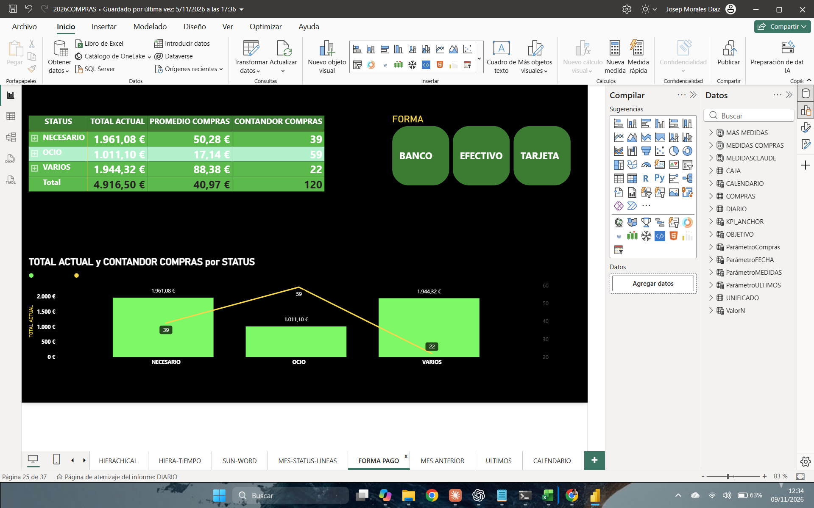

# Compras 2026 · Power BI

**Proyecto de portafolio de Josep**

Un informe para explorar cuánto se gasta, con qué frecuencia se compra y cómo evolucionan las compras y la caja durante 2026.

[Leer la presentación](presentacion.md) · [Ver las cuatro capturas](capturas/README.md) · [Descargar el informe de Power BI](2026COMPRAS.pbix)

## Compras en cifras

| Gasto registrado | Compras | Importe medio |
| ---: | ---: | ---: |
| **4.916,50 €** | **120** | **40,97 €** |

*Cifras de la vista Forma Pago en la captura del 9 de noviembre de 2026.*

## Principales hallazgos

- **Ocio fue el grupo con más compras.** Registró 59 de 120 operaciones, el 49,2 %, y representó el 20,6 % del gasto. Su importe medio fue de 17,14 €.
- **Varios tuvo el mayor importe medio.** Sus 22 compras sumaron 1.944,32 €, casi el mismo gasto que Necesario, que sumó 1.961,08 € en 39 compras. Los importes medios fueron de 88,38 € y 50,28 €, respectivamente.
- **Enero–marzo muestra el mayor importe trimestral de la vista temporal.** El gráfico muestra 1.743 € para ese trimestre, 1.400 € para abril–junio y 1.256 € para julio–septiembre. Octubre–diciembre mostraba 497 € en la captura de noviembre.
- **El indicador de caja subió en los meses visibles de la tabla.** Pasó de 1.669,00 en enero a 3.361,13 en agosto. Agosto presentó la mayor variación mensual porcentual visible en la tabla, con un 13,03 %.

## Explorar el informe

Abre [2026COMPRAS.pbix](2026COMPRAS.pbix) en Power BI Desktop. Empieza por **Compras** para ver el resumen y sigue por **Forma Pago** para comparar importe y frecuencia. Usa **Árbol** o **Hiera-Tiempo** para explorar el detalle y **Caja** para revisar su evolución mensual. El informe también incluye vistas de comparación con el mes anterior y seguimiento frente a un objetivo.

Los importes de enero que muestran **Árbol** y **Hiera-Tiempo** difieren (614 € y 581 €). La causa queda por verificar en Power BI. Cada hallazgo se refiere a la vista indicada.
