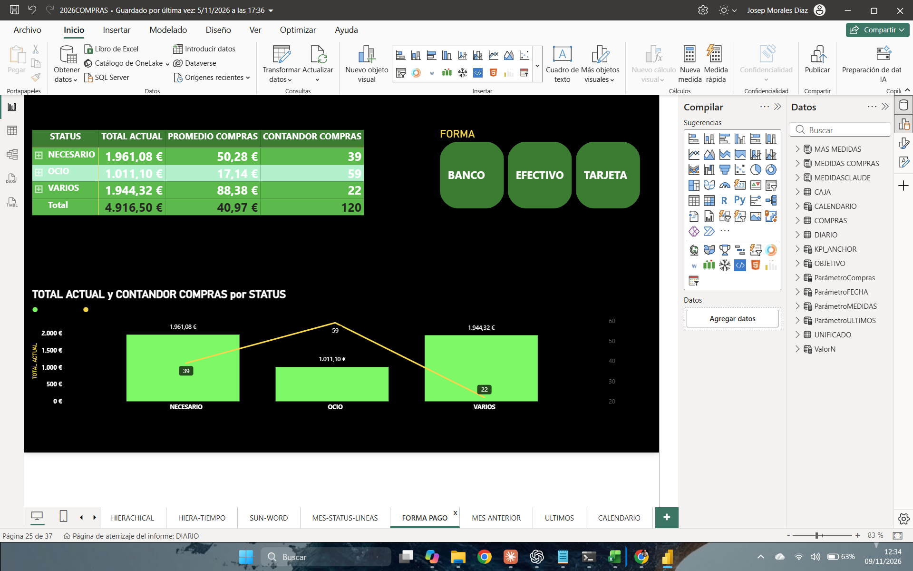
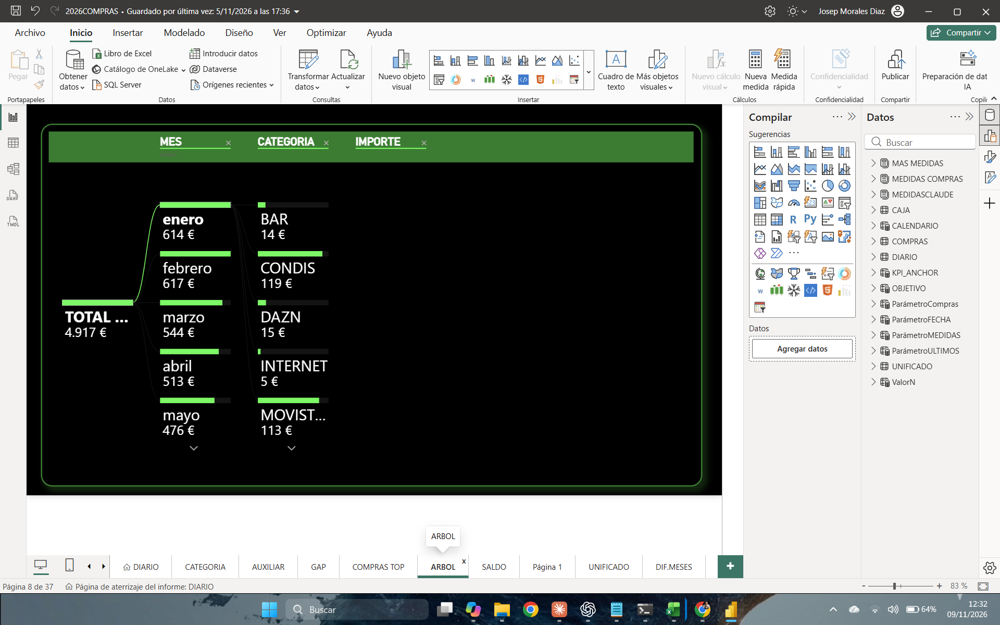
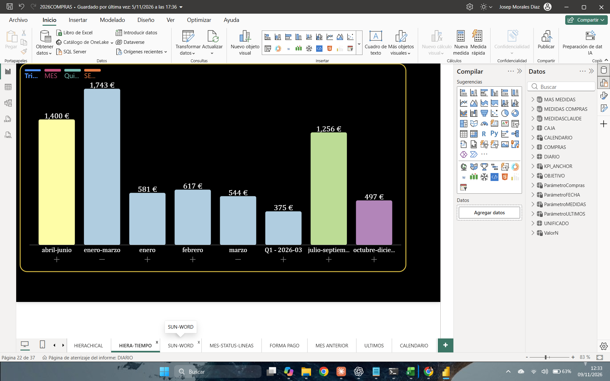
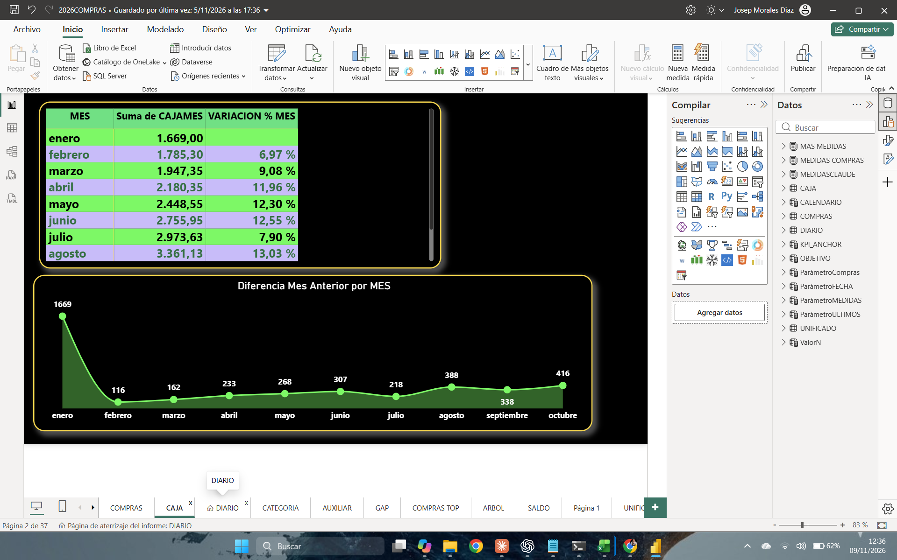

# Compras 2026

**Caso de estudio de Power BI · Josep**

## 1. El reto

El importe total permite saber cuánto se gastó. Para entender cómo se llegó a ese importe, el informe pone juntas tres cifras: el gasto, el número de compras y el importe medio. Desde ahí se puede explorar el detalle por periodo, categoría y forma de pago.

## 2. Comparar la frecuencia con el importe

La vista **Forma Pago** registra **4.916,50 € en 120 compras**, con una media de **40,97 €**. El selector permite explorar banco, efectivo o tarjeta. La tabla y el gráfico agrupan las operaciones en Necesario, Ocio y Varios.

| Grupo | Compras | Gasto | Importe medio |
| --- | ---: | ---: | ---: |
| Necesario | 39 | 1.961,08 € | 50,28 € |
| Ocio | 59 | 1.011,10 € | 17,14 € |
| Varios | 22 | 1.944,32 € | 88,38 € |

Ocio reúne casi la mitad de las operaciones y alrededor de una quinta parte del gasto. Varios se acerca al importe total de Necesario con 17 compras menos.

## 3. Pasar del total al detalle

**Árbol** muestra el total redondeado a 4.917 € y permite abrir un mes para consultar sus categorías. En la captura, enero aparece desplegado y se ven, entre otras, Condis (119 €), DAZN (15 €) y Bar (14 €).

**Hiera-Tiempo** permite comparar los trimestres y abrirlos para ver los meses. Enero–marzo suma 1.743 € en esa vista, el mayor importe trimestral mostrado. Al ampliar marzo aparece un nivel adicional con un importe de 375 €.

Las dos vistas muestran importes distintos para enero (614 € en Árbol y 581 € en Hiera-Tiempo). La causa queda por verificar en Power BI.

## 4. Revisar la evolución de caja

**Caja** reúne el importe por mes, la variación porcentual y la diferencia frente al mes anterior. La tabla pasa de 1.669,00 en enero a 3.361,13 en agosto. El gráfico muestra una diferencia de 416 en octubre, la mayor entre febrero y octubre en la captura.

[Volver al README](README.md) · [Abrir el informe de Power BI](2026COMPRAS.pbix)
